# Sentimen Publik: Analisis Media Sosial Pengunduran Diri Wapres

Project data analyst yang mengukur sentimen publik di media sosial
terhadap pengunduran diri Wakil Presiden Gibran Rakabuming Raka pada
12 November 2026, lengkap dengan analisis dampak (pasar, atensi publik,
dan interaksi dengan masalah nasional lain) serta modul proyeksi
statistik. Pengukuran dilakukan netral: distribusi dilaporkan
sebagaimana ditemukan, tanpa advokasi politik dan tanpa mengambil
posisi atas peristiwa tersebut.

Peristiwa yang diukur: Wakil Presiden menyerahkan surat pengunduran
diri kepada MPR dan Presiden Prabowo pada 12 November 2026, setelah
putusan kasasi Mahkamah Agung No. 742 K/TUN/2026 (30 Oktober 2026)
membatalkan surat penyetaraan pendidikannya dan 120 anggota DPR
mengusulkan Hak Menyatakan Pendapat pada 11 November 2026. Klaim
pengunduran diri yang sama sebelumnya beredar sebagai hoaks pada
Mei 2026 dan September sampai Oktober 2026.

## Hasil Utama

| Indikator | Nilai |
|---|---|
| Postingan mentah terkumpul | 1.369 |
| Postingan unik setelah dedup | 1.201 |
| Facebook | 413 postingan |
| Threads | 405 postingan |
| Instagram | 383 postingan |
| TikTok | 0 postingan (tidak tercakup alat yang tersedia) |
| Pengguna unik | 857 |
| Sentimen positif | 205 postingan (17,07%) |
| Sentimen negatif | 431 postingan (35,89%) |
| Sentimen netral | 565 postingan (47,04%) |
| Akurasi validasi mesin sentimen | 52,5% pada 120 sampel berlabel manual |
| Engagement tertinggi | Kelas negatif: rata rata 9.799 likes, median 1.300 |
| Dampak pasar utama (computed, project pendamping) | IHSG +2,6561% ke 5.250,90 pada 12 Nov 2026 |
| Proyeksi 14 hari | Volume meluruh ke lantai nol sekitar hari ke 7; porsi negatif 17,32% menuju 8,28% |

Distribusi sentimen per platform:

| Platform | Positif | Negatif | Netral | Porsi non netral |
|---|---|---|---|---|
| Facebook (413) | 103 (24,94%) | 180 (43,58%) | 130 (31,48%) | 68,52% |
| Instagram (383) | 67 (17,49%) | 148 (38,64%) | 168 (43,86%) | 56,14% |
| Threads (405) | 35 (8,64%) | 103 (25,43%) | 267 (65,93%) | 34,07% |

Indikator dampak utama (tipe dan sumber dinyatakan selalu; daftar
lengkap di data/impact_indicators.csv):

| Indikator | Nilai | Tipe | Sumber |
|---|---|---|---|
| Perubahan IHSG 12 Nov 2026 | +2,6561% | computed | Project pendamping MarketShock ID |
| Perubahan EIDO 12 Nov 2026 | +2,5465% | computed | Project pendamping MarketShock ID |
| Residu rupiah vs dolar global, 11 ke 16 Nov | -0,1677 poin persen | computed | Project pendamping MarketShock ID |
| Perubahan IHSG jendela putusan MA | -7,1486% | computed | Project pendamping MarketShock ID |
| Perubahan IHSG year to date ke 12 Nov | -39,2745% | computed | Project pendamping MarketShock ID |
| Beli bersih asing 12 Nov 2026 | Rp443,53 miliar | reported | Kontan |
| Postingan yang juga menyebut isu ekonomi | 38 (3,16%) | measured | Dataset project ini |
| Postingan yang juga menyebut isu bencana | 1 (0,08%) | measured | Dataset project ini |

Ringkasan proyeksi 14 hari (18 November sampai 1 Desember 2026, tren
Holt teredam): volume sampel diproyeksikan meluruh dari 35,95 postingan
pada hari pertama menuju lantai nol sekitar hari ketujuh, dengan pita
ketidakpastian yang sangat lebar; porsi negatif menurun dari 17,32% ke
8,28% dan porsi positif dari 12,34% ke 8,12%. Ini proyeksi statistik
dari sampel terbatas, bukan ramalan fakta.

## Visual Hasil

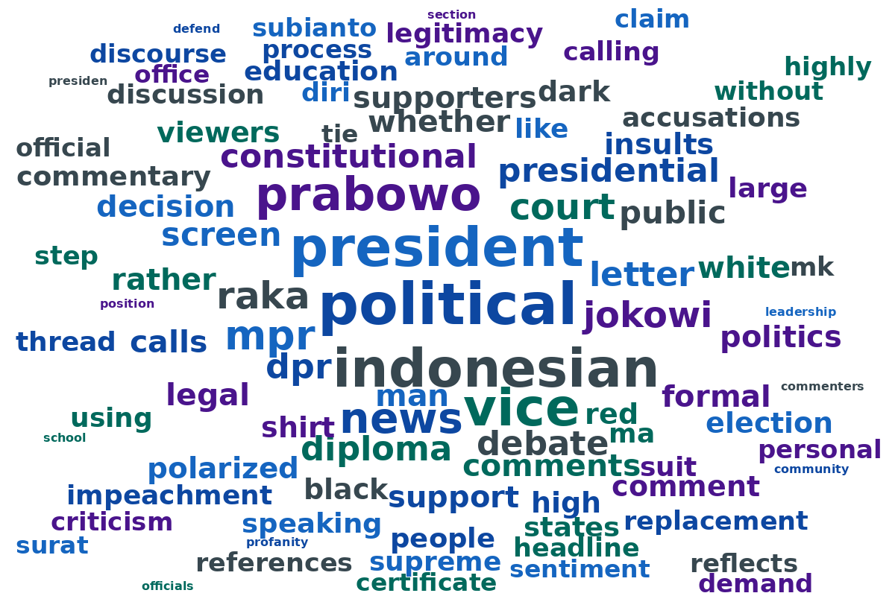

Awan kata keseluruhan dari 1.201 postingan. Kata yang mendominasi antara
lain president, political, prabowo, mpr, dpr, jokowi, court, dan diploma.
Kata kunci pencarian, kata henti, dan kata templat ringkasan layanan
dikeluarkan dari awan kata; tabel frekuensi mentah tetap menyertakannya
(kata terbanyak: gibran, 5.225 kemunculan).

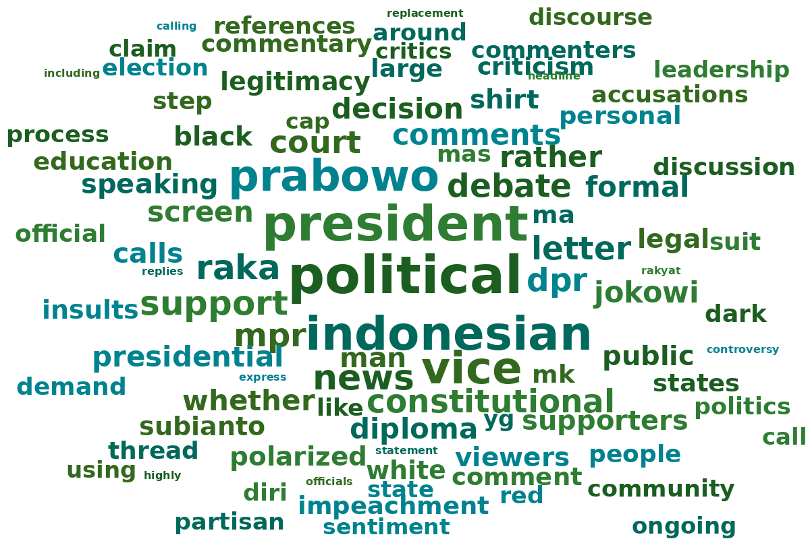

Awan kata kelas positif (205 postingan, 17,07%): tema dukungan dan
konstitusionalitas, dengan kata support dan constitutional menonjol.

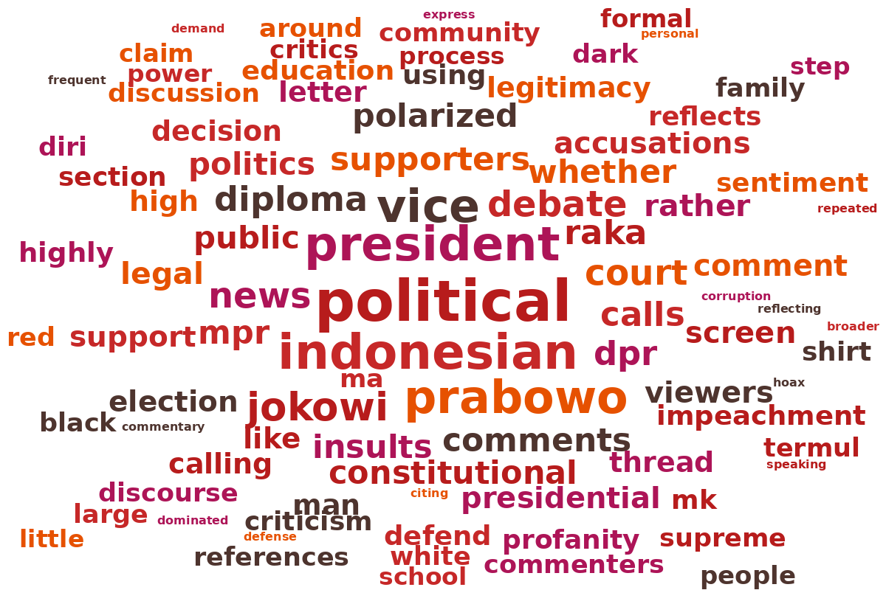

Awan kata kelas negatif (431 postingan, 35,89%): tema ijazah dan
perdebatan pendukung, dengan kata diploma, jokowi, dan polarized
menonjol. Kelas ini juga memperoleh engagement tertinggi.

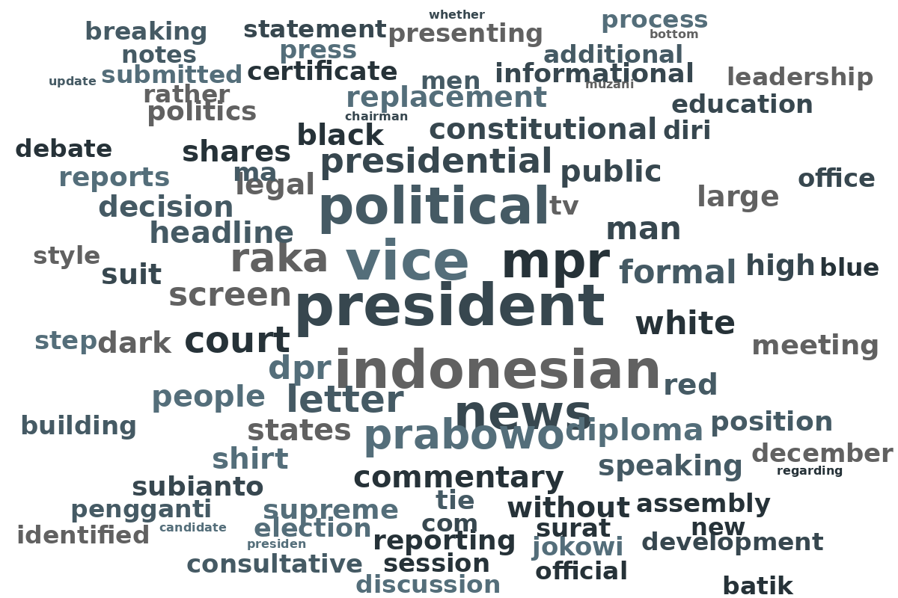

Awan kata kelas netral (565 postingan, 47,04%): tema prosedur dan
pemberitaan, dengan kata letter, mpr, dan consultative assembly
menonjol.

Awan kata per platform: [Threads](wordclouds/awan_kata_threads.png),
[Instagram](wordclouds/awan_kata_instagram.png),
[Facebook](wordclouds/awan_kata_facebook.png). Awan kata TikTok tidak
dibuat karena nol postingan TikTok terkumpul.

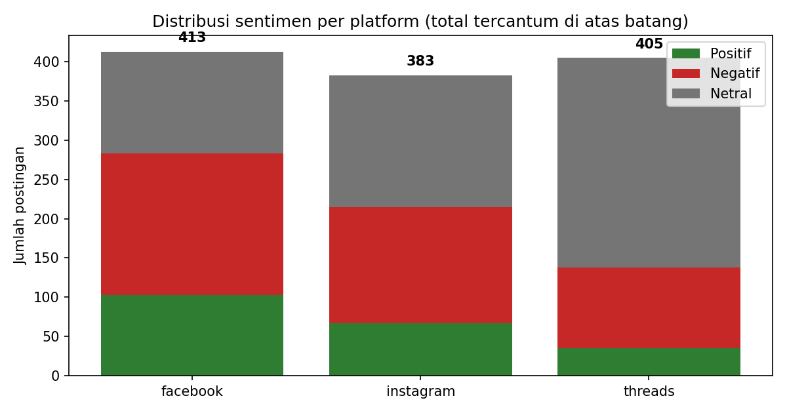

Distribusi sentimen per platform. Facebook paling terpolarisasi dengan
porsi non netral 68,52% dan 180 postingan negatif; Threads paling netral
dengan 65,93% postingan netral, sebagian karena didominasi tautan berita.

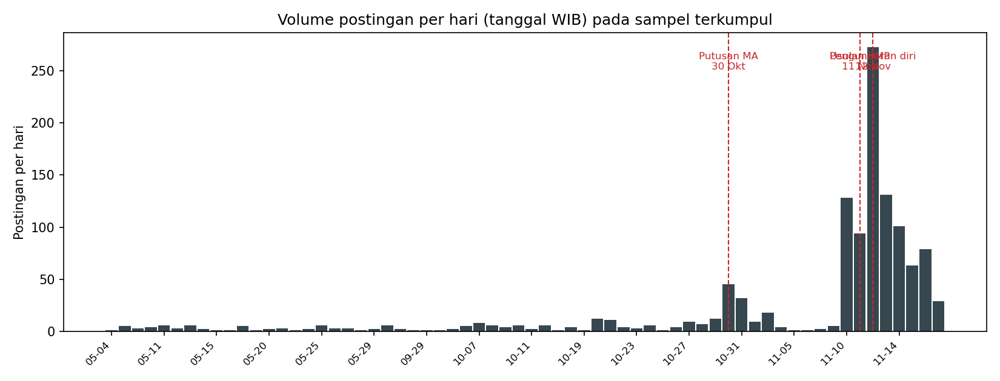

Volume postingan per hari pada sampel terkumpul. Puncak pada
12 November 2026 dengan 273 postingan, diikuti 13 November (131) dan
10 November (128). Volume sampel bias menurut desain pengambilan dan
tidak menggambarkan volume percakapan platform yang sebenarnya.

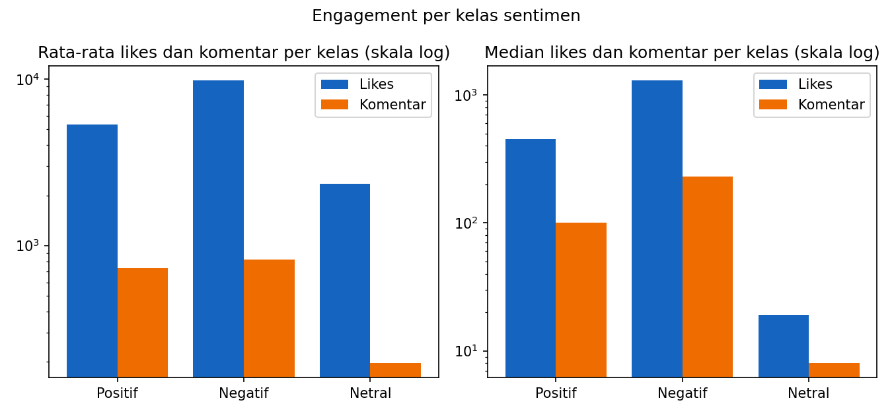

Engagement per kelas sentimen. Postingan negatif berjalan paling jauh:
rata rata 9.799 likes dan median 1.300, berbanding positif 5.341 dan
450, serta netral 2.338 dan 19.

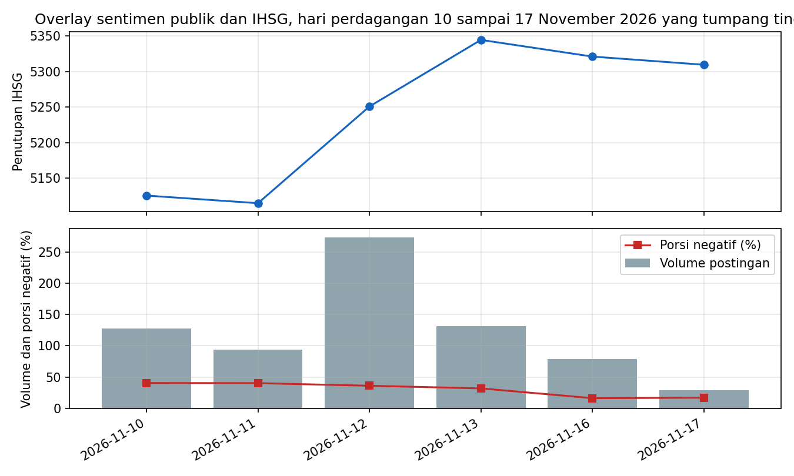

Overlay agregat sentimen harian dengan penutupan IHSG pada enam hari
perdagangan yang tumpang tindih (10, 11, 12, 13, 16, 17 November 2026).
Porsi negatif menurun dari 40,62% ke 17,24% sementara IHSG naik;
jendela terlalu kecil untuk klaim korelasi dan pola ini dibaca
deskriptif saja, tanpa inferensi kausalitas.

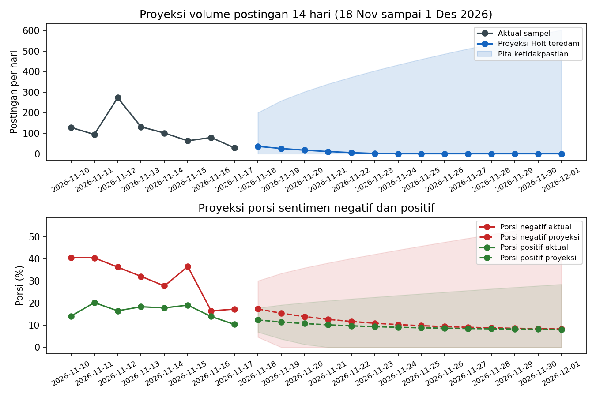

Proyeksi tren Holt teredam 14 hari dengan pita ketidakpastian. Proyeksi
titik volume mencapai lantai nol sekitar hari ketujuh, sementara pita
atas tetap di kisaran ratusan: ketidakpastian mendominasi hasil.

## Screenshot Hasil Dashboard

Dua tangkapan layar berikut diambil langsung dari berkas
`dashboard/sentimen_dashboard.html` yang dirender apa adanya, tanpa
pengeditan gambar. Seluruh angka yang tampil di dalamnya sama dengan
angka di tabel Hasil Utama di atas.

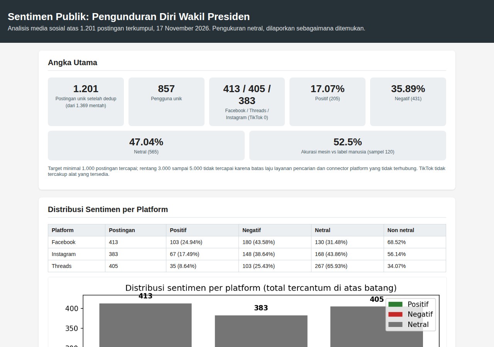

Tampak atas dashboard: 1.201 postingan unik dari 857 pengguna, Facebook
413, Threads 405, Instagram 383 (TikTok 0), positif 17,07%, negatif
35,89%, netral 47,04%, dan akurasi mesin 52,5% terhadap label manusia,
diikuti tabel distribusi sentimen per platform.

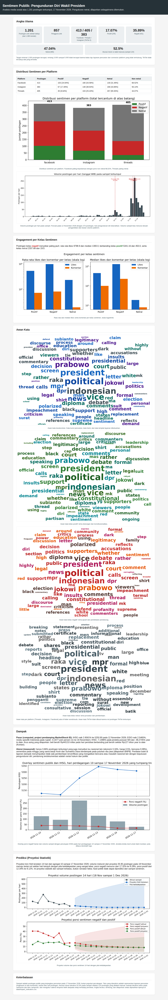

Satu halaman penuh dashboard, memuat seluruh grafik, awan kata, temuan
dampak, dan modul prediksi dalam satu tampilan.

## Metode

1. Pengumpulan: layanan pencarian media sosial, 28 panggilan berhasil
   sebelum batas laju HTTP 429 menghentikan pengumpulan secara
   permanen. Connector Threads, Instagram, dan Facebook tidak terhubung
   pada lingkungan pengumpulan; TikTok tidak tercakup alat apa pun yang
   tersedia. Detail di data/collection_notes.md.
2. Deduplikasi menurut URL ternormalisasi lalu teks ternormalisasi:
   1.369 menjadi 1.201 postingan.
3. Teks yang dianalisis adalah representasi layanan untuk tiap postingan
   (ringkasan isi, ringkasan komentar, fokus reaksi), berbahasa Inggris
   bercampur kutipan Bahasa Indonesia. Ini keterbatasan representasi
   yang dinyatakan terbuka.
4. Mesin sentimen leksikon Bahasa Indonesia berbobot dengan frasa khusus,
   penanganan negasi (tidak, bukan, jangan, nggak, gak, dan lainnya)
   dalam jendela dua token, penguat dan pelemah, ditambah suplemen kata
   sentimen Bahasa Inggris. Label adalah sikap terhadap peristiwa
   pengunduran diri; ambang skor positif 1,0 dan negatif -1,0.
5. Validasi: 120 postingan sampel acak (seed 42) dilabeli manual oleh
   pembaca manusia; akurasi mesin 52,5% (positif 36,7%, negatif 75,0%,
   netral 57,0%). Kesalahan terbesar adalah postingan netral yang dibaca
   mesin sebagai negatif, dan postingan penyambut pengunduran diri yang
   teksnya penuh emosi negatif terhadap sosoknya. Mesin mengukur valensi
   ekspresi lebih daripada sikap; distribusi di atas harus dibaca
   dengan kaveat ini.
6. Dampak pasar tidak dihitung ulang di sini; angka computed dikutip
   dari project pendamping MarketShock ID. Kompetisi atensi diukur dari
   kelompok kata kunci terdokumentasi (bencana, harga, ekonomi).
7. Proyeksi memakai tren Holt teredam (alpha 0,5, beta 0,3, phi 0,8)
   atas agregat harian 10 sampai 17 November 2026.

## Dokumen dan data

- docs/findings_report.md: laporan temuan lengkap.
- docs/impact_analysis.md: analisis dampak, termasuk penilaian bukti
  bahwa tidak ada pemberitaan terverifikasi yang mengaitkan bencana
  atau masalah nasional lain dengan keputusan pengunduran diri;
  pendorong terdokumentasi adalah rantai hukum dan politik.
- docs/prediction_outlook.md: metode proyeksi, skenario milestone
  jendela 60 hari, dan indikator yang perlu dipantau.
- dashboard/sentimen_dashboard.html: dashboard mandiri satu berkas.
- data/: posts_raw.csv, posts_clean.csv, labeled_sample.csv,
  word_frequencies.csv, bigram_frequencies.csv, impact_indicators.csv,
  prediction_sentiment.csv, collection_notes.md.
- output/analysis_results.json: seluruh angka analisis dalam satu
  berkas terstruktur.

## Keterbatasan

Sampel adalah postingan publik yang terjangkau pencarian pada
17 November 2026, bukan populasi percakapan media sosial; distribusi
tanggalnya bias menurut desain pengambilan. Target rentang atas 3.000
sampai 5.000 postingan tidak tercapai (tercapai 1.201 unik) dan TikTok
sama sekali tidak tercakup. Teks yang dianalisis adalah representasi
layanan, bukan teks asli postingan. Akurasi mesin sentimen 52,5% pada
validasi. Angka measured, computed, dan reported dipisahkan tipenya di
seluruh dokumen dan berkas data. Proyeksi adalah demonstrasi metode
peramalan dari sampel terbatas; hasil politik tidak dapat diprediksi
secara andal dari sampel sentimen.

## Reproduksi

```bash
python3 analysis/collect_posts.py     # parse keluaran pencarian tersimpan
python3 analysis/preprocess.py        # deduplikasi
python3 analysis/run_analysis.py      # klasifikasi, statistik, dampak, proyeksi
python3 analysis/build_charts.py      # grafik
python3 analysis/build_wordclouds.py  # awan kata (PIL)
python3 analysis/build_dashboard.py   # dashboard HTML
python3 -m unittest discover -s tests # pengujian
```

Urutan di atas mereproduksi seluruh keluaran dari data mentah yang
tersimpan di repo ini. Pengumpulan ulang dari layanan pencarian tidak
dijamin menghasilkan sampel yang sama, karena hasil pencarian berubah
dari waktu ke waktu.
